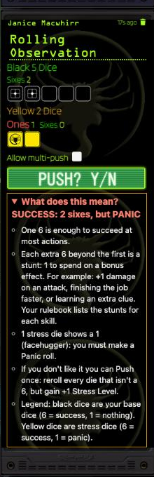

# Explain My Roll

A tiny [Foundry VTT](https://foundryvtt.com) (v13–14) module for the **Alien RPG** system, made for tables where everyone is new to the rules.

<p align="center"></p>

Under every roll card in chat it adds a collapsible **"What does this mean?"** line that says, in plain words, what the dice did:

- **Success or fail**, and why one 6 is enough.
- **Stunts**: each extra 6 beyond the first, with a few examples of what to spend them on.
- **Stress dice 1s** (the facehugger) and the Panic roll they cause.
- **Pushing**: what it does, whether you can still push, and what a pushed roll's total means.
- **Supply rolls**: each 1 uses up a point.
- A one-line dice legend (black base dice, yellow stress dice).

The heading is colour-coded: green for success, red for a failed roll or a Panic roll.

It reads what the card shows, so it also works on old messages and for every player and GM, and it never changes a roll. Radiation rolls are left alone because their cards already explain themselves.

## Install

In Foundry: **Add-on Modules → Install Module**, and paste this manifest URL:

```
https://github.com/bohn002/explain-my-roll/releases/latest/download/module.json
```

Then enable **Explain My Roll** in your world. Requires Foundry v13 or v14 and the [Alien RPG system](https://foundryvtt.com/packages/alienrpg). Each player can switch it off under **Configure Settings → Explain My Roll**.

## Roadmap

- **More systems.** Right now it only understands the Alien RPG system. The plan is to add the other popular ones (Year Zero siblings like Forbidden Lands, then D&D 5e, Pathfinder 2e and Call of Cthulhu). Each needs its own reader for that system's chat cards plus accurate rules text.

## Notes

The rules wording is a plain summary, not a replacement for the rulebook. If the explanation and your book disagree, trust the book and open an issue.

## Credits and license

Code is released under the [MIT License](LICENSE). *This is an unofficial fan module. It is not affiliated with or endorsed by Free League Publishing, Foundry Gaming LLC or the owners of the ALIEN franchise.*
